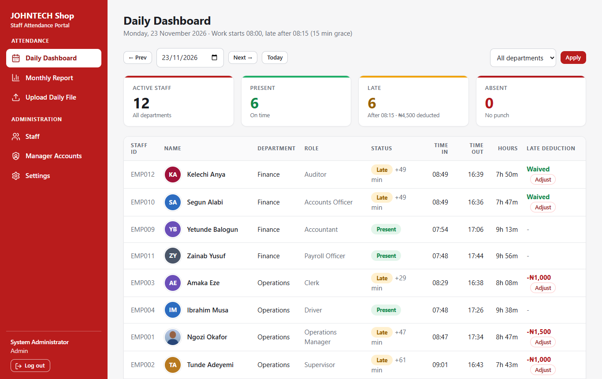
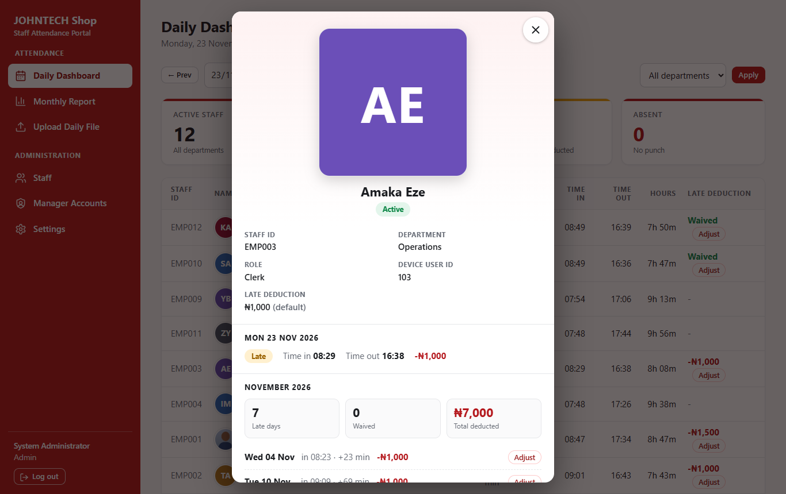
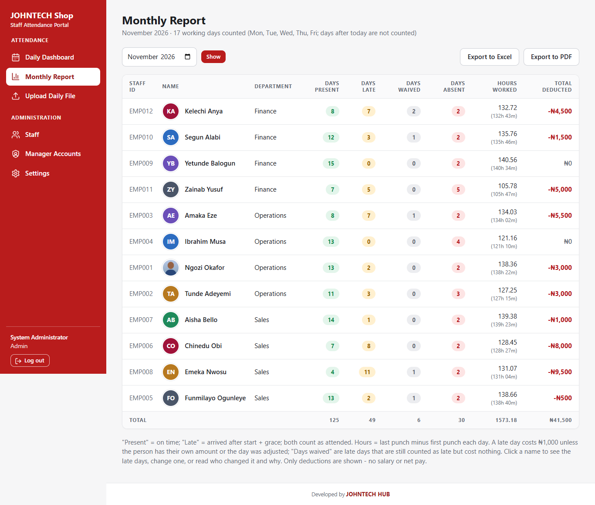
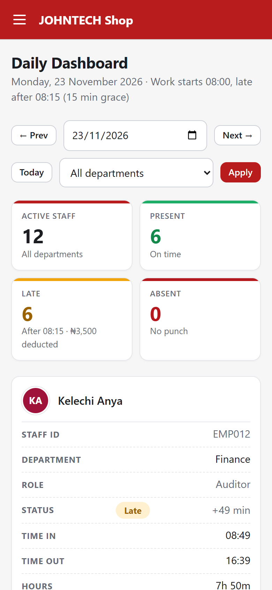
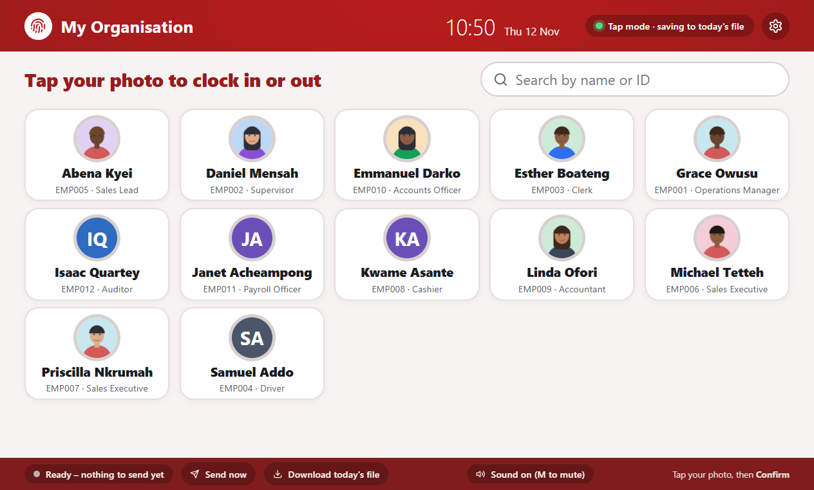
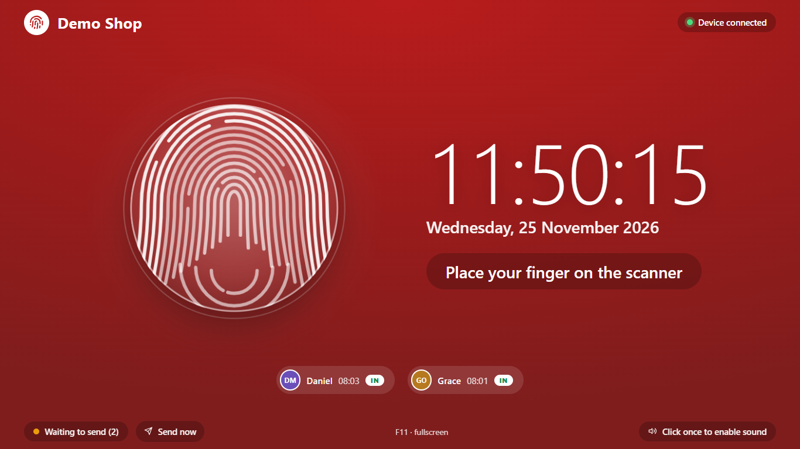
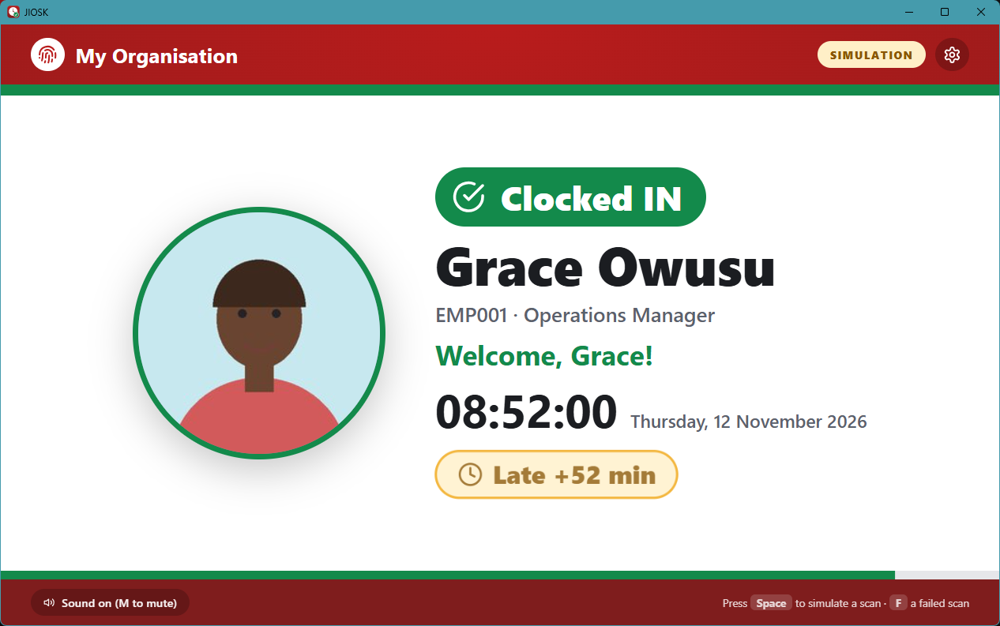

# Staff Attendance Portal + JIOSK Kiosk

An attendance system for small shops and offices. Staff clock in with a fingerprint device or a touch screen; managers see who is in, who is late and what lateness costs.

> A commercial project for a small retail business. The source is private; this page is a showcase.

## Who it is for

Owners and managers who want reliable attendance without paper registers or an on-site technician.

## Main features

- **Daily dashboard** with staff photos; click a face for a full profile.
- **Monthly reports** with Excel and PDF export.
- **Late deductions in naira**: grace period, default or per-person amounts, waive or change a day with an optional reason, and an append-only audit trail. No payroll.
- **Admin and manager accounts**; configurable work hours, working days and timezone.
- **Touch-screen kiosk**: staff tap their photo to clock in, with an optional PIN.
- **Fingerprint mode** for ZKTeco devices, with a live scanning screen.
- **Offline-first**: scans are saved on the laptop, then sent when online, never twice.
- **Windows installer**, and manual daily-file upload as backup.

## Tech stack

Python, FastAPI, SQLModel/SQLAlchemy, Jinja2, SQLite and MySQL/MariaDB, openpyxl, reportlab, Pillow, pyzk, plain HTML/CSS/JavaScript, pytest and Playwright, PyInstaller, Inno Setup, Edge WebView2.

## What I built

I built the whole system (portal, kiosk, Windows app, exports and hosting setup) and put it live on shared cPanel hosting. Problems solved:

- **No lost or doubled punches.** Scans are stored, queued, retried and recognised by person and exact time, so resends and late uploads add nothing twice.
- **Safe upgrades of live data.** A repeatable script makes additive changes on SQLite and MySQL, rehearsed on a throwaway MariaDB.
- **Tight shared hosting.** Lazy loading keeps each worker light; a step-by-step guide suits a non-technical owner.
- **Money and time.** Whole-naira amounts, ₦ in PDFs via an embedded font, and its own timezone setting.
- **Security.** CSRF protection, strict content policy, scrypt password hashing, and a token-protected kiosk API with certificate checking always on.
- **Plain-language status messages** instead of error codes.

Over 340 automated tests.

## Honest status

- Device sending is tested with a simulated device; the physical device check is still to do.
- The installer is not code-signed, so Windows shows a warning.
- It serves one business; it is not multi-tenant.

## Screenshots

All screenshots use invented demo staff.

